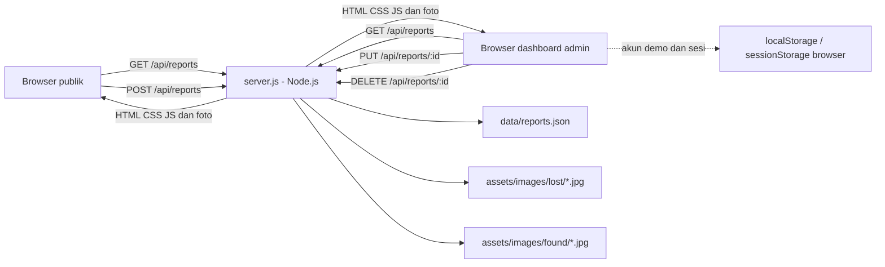

# Software Requirements Specification (SRS)

## Lost & Found Campus

| Informasi dokumen | Keterangan                                                         |
| ----------------- | ------------------------------------------------------------------ |
| Versi             | 1.0                                                                |
| Tanggal           | 13 Oktober 2026                                                    |
| Tujuan            | Acuan implementasi, pengujian, dan presentasi proyek               |
| Platform          | Website responsif dengan HTML, CSS, JavaScript, dan server Node.js |
| Status            | Demo file-based untuk penggunaan lokal                             |

## 1. Ringkasan

Lost & Found Campus membantu civitas kampus melaporkan barang hilang atau ditemukan, mencari laporan, melihat detail dan kontak pelapor, serta mengelola laporan melalui dashboard admin.

Sistem memiliki dua area. Website publik digunakan pelapor dan pencari barang. Dashboard admin digunakan untuk mengubah status/detail, mengelola foto, menghapus, mencetak laporan, serta mengelola akun admin demo. Keduanya membaca data yang sama dari server Node.js.

## 2. Tujuan dan Ruang Lingkup

### Tujuan

- Memusatkan informasi barang hilang dan ditemukan dalam satu daftar.
- Memudahkan pencarian melalui kata kunci, kategori, dan status.
- Menyediakan pengelolaan laporan dan foto pada dashboard.
- Menyimpan laporan ke file proyek agar bertahan setelah halaman atau server dimulai ulang.

### Cakupan

- Beranda dan statistik otomatis.
- Daftar laporan, pencarian, filter, dan detail modal.
- Form laporan dengan validasi serta foto opsional.
- Dashboard admin dengan ringkasan, filter, edit, hapus, galeri foto, cetak, dan daftar admin demo.
- API Node.js dan penyimpanan file JSON/JPEG.

### Di luar cakupan demo

- Database relasional atau cloud storage.
- Sinkronisasi ke internet atau perangkat lain.
- Autentikasi dan otorisasi produksi.
- Pengiriman notifikasi email, WhatsApp, atau push notification.
- Histori/audit lengkap atas semua perubahan.

## 3. Aktor dan Hak Akses

| Aktor              | Kegiatan                                                                                           | Batasan                                                                         |
| ------------------ | -------------------------------------------------------------------------------------------------- | ------------------------------------------------------------------------------- |
| Pengunjung/pelapor | Melihat, mencari, memfilter, membuka detail, dan mengirim laporan                                  | Kontak laporan terlihat di detail publik                                        |
| Admin demo         | Masuk dashboard, mengedit status/detail/foto, menghapus dan mencetak laporan, mengelola admin demo | Kredensial dan akun tambahan masih dikelola di browser; bukan keamanan produksi |
| Server Node.js     | Menyajikan halaman, memvalidasi API, membaca/menulis data laporan dan foto                         | Default hanya mendengarkan `127.0.0.1` pada port `3000`                         |

## 4. Arsitektur Sistem



### Komponen

| Komponen                                                         | Peran                                                                                             |
| ---------------------------------------------------------------- | ------------------------------------------------------------------------------------------------- |
| `index.html`, `style.css`, `script.js`                           | Antarmuka publik, validasi form, pencarian/filter, render kartu, foto, modal, dan pemanggilan API |
| `admin/index.html`, `assets/css/admin.css`, `assets/js/admin.js` | Login demo dan dashboard pengelolaan laporan                                                      |
| `server.js`                                                      | Server HTTP, API laporan, validasi server-side, pengamanan path, dan operasi file                 |
| `data.json`                                                      | Seed enam laporan contoh untuk inisialisasi awal dan mode pratinjau statis                        |
| `data/reports.json`                                              | Daftar laporan aktif yang menjadi sumber data utama saat server Node berjalan                     |
| `assets/images/lost/`                                            | Foto fisik untuk laporan berstatus `Hilang`                                                       |
| `assets/images/found/`                                           | Foto fisik untuk laporan berstatus `Ditemukan`                                                    |

## 5. Alur Kerja Pengguna

### 5.1 Mencari barang

1. Pengunjung membuka bagian **Laporan**.
2. JavaScript meminta `GET /api/reports` dan merender hasil sebagai kartu.
3. Pengunjung mencari nama barang dan dapat menggabungkan filter kategori serta status.
4. Kartu yang dipilih membuka detail, foto (jika tersedia), lokasi, tanggal kejadian, deskripsi, dan kontak.
5. Pengunjung menghubungi pelapor untuk mencocokkan ciri barang.

### 5.2 Mengirim laporan publik

1. Pelapor mengisi nama, kategori, status, lokasi, tanggal kejadian, deskripsi, dan kontak.
2. JavaScript memeriksa kolom wajib, nama minimal 3 karakter, format kontak, serta tanggal yang tidak di masa depan.
3. Foto bersifat opsional. Jika dipilih, JPG/PNG/WebP maksimal 8 MB diperkecil di browser hingga sisi terpanjang 1600 px dan dikirim sebagai JPEG.
4. Browser mengirim `POST /api/reports`.
5. Server memvalidasi payload, membuat ID, menyimpan foto ke folder status (jika ada), lalu menulis laporan ke `data/reports.json`.
6. Server mengirim laporan yang tersimpan. Halaman publik menampilkan kartu dan pesan sukses hanya setelah respons berhasil.
7. Dashboard dan tab publik lain menerima sinyal perubahan dan memuat ulang data dari API.

### 5.3 Mengelola laporan di dashboard

1. Admin membuka `/admin/` dan masuk memakai akun demo.
2. Dashboard meminta daftar dari `GET /api/reports`, lalu menghitung statistik, laporan terbaru, kategori, dan foto.
3. Admin mencari/filter laporan, kemudian memilih **Edit**, **Cetak**, atau **Hapus**.
4. Saat menyimpan edit, dashboard mengirim `PUT /api/reports/:id`. Server memvalidasi data, mencatat `updatedAt`, memperbarui JSON, serta menyimpan/memindahkan/menghapus foto sesuai perubahan.
5. Saat menghapus, dashboard mengirim `DELETE /api/reports/:id`. Server menghapus record dan foto milik laporan tersebut.
6. Halaman publik menerima notifikasi perubahan dan memuat ulang daftar agar status terbaru terlihat.

### 5.4 Perpindahan foto ketika status berubah

| Perubahan status             | Tindakan server                                                                                              |
| ---------------------------- | ------------------------------------------------------------------------------------------------------------ |
| `Hilang` menjadi `Ditemukan` | Foto dipindahkan dari `assets/images/lost/` ke `assets/images/found/`; properti `photo` pada JSON diperbarui |
| `Ditemukan` menjadi `Hilang` | Foto dipindahkan dari `assets/images/found/` ke `assets/images/lost/`; properti `photo` diperbarui           |
| Foto baru diunggah saat edit | Server menyimpan JPEG baru dengan nama berdasarkan ID laporan dan menghapus foto lama yang dikelola server   |
| Foto dihapus dari editor     | Server menghapus file fisik dan menghapus properti `photo`                                                   |
| Laporan dihapus              | Server menghapus record dan file foto terkait                                                                |

## 6. Kebutuhan Fungsional

| ID    | Kebutuhan                                        | Kriteria penerimaan                                                                                |
| ----- | ------------------------------------------------ | -------------------------------------------------------------------------------------------------- |
| FR-01 | Sistem menampilkan ringkasan laporan             | Total, hilang, dan ditemukan sesuai hasil API                                                      |
| FR-02 | Sistem menampilkan daftar laporan sebagai kartu  | Kartu berisi nama, kategori, status, lokasi, tanggal, dan foto opsional                            |
| FR-03 | Sistem menyediakan pencarian dan filter gabungan | Kata kunci, kategori, dan status menyaring daftar tanpa reload halaman                             |
| FR-04 | Sistem menampilkan detail laporan                | Modal memuat deskripsi, kontak, lokasi, tanggal, dan foto bila ada                                 |
| FR-05 | Sistem menerima laporan baru                     | Validasi sisi klien dan server lulus sebelum laporan disimpan                                      |
| FR-06 | Foto publik opsional                             | Tanpa foto laporan tetap dapat disimpan; dengan foto, file berada di folder status                 |
| FR-07 | Sistem menyediakan status data                   | Publik/admin menampilkan bahwa data tersimpan di server atau berada di mode pratinjau              |
| FR-08 | Admin melihat ringkasan, tabel, dan galeri foto  | Metrik, filter, status, tanggal, sumber, dan foto berasal dari API yang sama                       |
| FR-09 | Admin dapat mengubah laporan                     | Edit status/detail mengubah `data/reports.json`; foto berpindah bila status berubah                |
| FR-10 | Admin dapat menghapus laporan                    | Record terhapus dari API serta foto fisik terkait dihapus                                          |
| FR-11 | Admin dapat mencetak                             | Detail individu atau daftar laporan dapat dicetak melalui dialog cetak browser                     |
| FR-12 | Admin dapat mendaftarkan akun demo lain          | Akun dapat login pada browser/origin yang sama; admin aktif dan admin terakhir tidak dapat dihapus |
| FR-13 | Perubahan terlihat di kedua halaman              | Setelah operasi berhasil, halaman/tab lain memuat data terbaru dari API                            |
| FR-14 | Sistem menolak akses langsung ke database file   | `/data/reports.json` tidak disajikan sebagai aset statis; gunakan API                              |

## 7. Aturan Validasi dan Batas Data

| Data                      | Aturan                                                                                      |
| ------------------------- | ------------------------------------------------------------------------------------------- |
| Nama barang               | Wajib, 3–80 karakter                                                                        |
| Kategori                  | Salah satu dari Elektronik, Dokumen, Tas, Kunci, Aksesori, Pakaian, Lainnya                 |
| Status                    | Hanya `Hilang` atau `Ditemukan`                                                             |
| Lokasi                    | Wajib, maksimal 120 karakter                                                                |
| Tanggal kejadian          | Format `YYYY-MM-DD`, tidak boleh melewati tanggal lokal hari ini                            |
| Deskripsi                 | Wajib, maksimal 600 karakter                                                                |
| Kontak                    | Wajib; email sederhana atau nomor HP dengan format angka/karakter pemisah yang didukung     |
| Foto                      | Opsional; JPG, PNG, WebP, maksimal 8 MB sebelum kompresi; browser mengirim JPEG terkompresi |
| Request API               | JSON body maksimal 12 MiB                                                                   |
| Username admin tambahan   | 3–24 karakter: huruf, angka, titik, garis bawah, atau tanda hubung                          |
| Kata sandi admin tambahan | Minimal 8 karakter; pada demo tersimpan sebagai teks biasa di browser                       |

## 8. API Sistem

| Metode   | Endpoint             | Tujuan                                    | Hasil normal                                     |
| -------- | -------------------- | ----------------------------------------- | ------------------------------------------------ |
| `GET`    | `/api/reports`       | Membaca seluruh laporan aktif             | `200` dan array laporan JSON                     |
| `POST`   | `/api/reports`       | Membuat laporan baru                      | `201` dan objek laporan yang disimpan            |
| `PUT`    | `/api/reports/:id`   | Mengubah detail/status/foto laporan       | `200` dan objek terbaru; `404` jika ID tidak ada |
| `DELETE` | `/api/reports/:id`   | Menghapus laporan dan foto terkait        | `200` dan `{ "deleted": true, "id": "..." }`     |
| `GET`    | `/data/reports.json` | Akses database mentah sebagai file statis | Selalu ditolak (`404`)                           |

Kesalahan validasi dikembalikan dalam JSON dengan status `400`; body terlalu besar ditolak dengan `413`. Klien menampilkan pesan sukses hanya setelah respons API berhasil.

## 9. Kamus Data Laporan

| Field         | Tipe             | Keterangan                                                            |
| ------------- | ---------------- | --------------------------------------------------------------------- |
| `id`          | String           | ID sampel tetap (`sample-*`) atau UUID untuk laporan baru             |
| `name`        | String           | Nama barang                                                           |
| `category`    | String           | Kategori barang                                                       |
| `status`      | Enum             | `Hilang` atau `Ditemukan`                                             |
| `location`    | String           | Lokasi terakhir/ditemukan                                             |
| `date`        | String           | Tanggal kejadian, `YYYY-MM-DD`                                        |
| `description` | String           | Ciri dan keterangan barang                                            |
| `contact`     | String           | Email atau nomor HP pelapor                                           |
| `createdAt`   | String           | Tanggal laporan dibuat                                                |
| `updatedAt`   | String           | Tanggal terakhir diperbarui; contoh lama dapat belum memiliki nilai   |
| `source`      | String           | `sample` atau `user`                                                  |
| `photo`       | String, opsional | URL file JPEG dalam `assets/images/lost/` atau `assets/images/found/` |

Contoh record tersimpan:

```json
{
  "id": "uuid-laporan",
  "name": "Dompet kulit cokelat",
  "category": "Aksesori",
  "status": "Hilang",
  "location": "Perpustakaan lantai 2",
  "date": "2026-10-10",
  "description": "Dompet kulit dengan ciri khusus.",
  "contact": "mahasiswa@kampus.ac.id",
  "createdAt": "2026-10-13",
  "updatedAt": "2026-10-13",
  "source": "user",
  "photo": "/assets/images/lost/uuid-laporan.jpg"
}
```

## 10. Peta Berkas dan Kode

### Berkas antarmuka dan data

| Berkas                                                          | Fungsi utama                                                                                                 |
| --------------------------------------------------------------- | ------------------------------------------------------------------------------------------------------------ |
| `index.html`                                                    | Struktur beranda, statistik, filter, kartu, form, notifikasi, dan modal detail publik                        |
| `style.css`                                                     | Gaya publik, tata letak responsif, foto, transisi, entrance/reveal, dan reduced-motion                       |
| `script.js`                                                     | Validasi, kompresi foto, pemanggilan API, render kartu/statistik, filter, modal, toast, dan sinkronisasi tab |
| `admin/index.html`                                              | Struktur login, sidebar, ringkasan, tabel, galeri, daftar admin, dan editor laporan                          |
| `assets/css/admin.css`                                          | Gaya dashboard, tabel, galeri, form akun, dialog edit, cetak, dan responsivitas                              |
| `assets/js/admin.js`                                            | Login demo, pengelolaan akun, GET/PUT/DELETE API, metrik, filter, foto, toast, dan cetak                     |
| `data.json`                                                     | Seed enam laporan awal; dipakai untuk menginisialisasi database saat file database belum ada                 |
| `data/reports.json`                                             | Database file-based utama untuk laporan aktif                                                                |
| `server.js`                                                     | HTTP server, route API, validasi server, serialisasi operasi tulis, serta CRUD foto/JSON                     |
| `README.md`                                                     | Panduan run, fitur, keamanan, struktur, dan troubleshooting                                                  |
| `docs/SRS.md`                                                   | Spesifikasi formal dan naskah presentasi proyek                                                              |
| `assets/images/lost/README.md`, `assets/images/found/README.md` | Aturan penempatan foto fisik berdasarkan status barang                                                       |

### Fungsi penting di `server.js`

| Fungsi                                  | Peran                                                                                  |
| --------------------------------------- | -------------------------------------------------------------------------------------- |
| `sendJson`                              | Mengirim response JSON dengan header content type dan no-store                         |
| `localDate`                             | Membuat tanggal lokal `YYYY-MM-DD`                                                     |
| `fail`                                  | Membuat error API beserta status HTTP                                                  |
| `readJsonBody`                          | Membaca body dan membatasi request hingga 12 MiB                                       |
| `readReports` / `writeReports`          | Membaca database JSON dan menulis ulang melalui file sementara lalu rename             |
| `updateDatabase`                        | Mengantre operasi tulis agar perubahan bersamaan tidak saling menimpa                  |
| `readDatabase`                          | Menunggu antrean tulis sebelum membaca data terbaru                                    |
| `normalizeReport`                       | Normalisasi serta validasi nama, kategori, status, tanggal, deskripsi, dan kontak      |
| `managedPhotoPath` / `photoDestination` | Memetakan URL foto yang dikelola server ke folder fisik yang diizinkan                 |
| `storePhoto`                            | Memvalidasi JPEG base64, menulis foto, dan membersihkan foto lama                      |
| `movePhoto` / `removeManagedPhoto`      | Memindahkan foto antarfolder status atau menghapusnya                                  |
| `handleApi`                             | Menangani GET/POST/PUT/DELETE `/api/reports`                                           |
| `serveStatic`                           | Menyajikan HTML/CSS/JS/foto serta memblokir path database mentah dan path traversal    |
| `initialize`                            | Membuat folder storage dan mengisi seed dari `data.json` hanya saat database belum ada |
| Handler `http.createServer`             | Merutekan request, membatasi metode HTTP, dan mengirim error terstruktur               |

### Fungsi penting di `script.js` (publik)

| Fungsi                                                                | Peran                                                                                       |
| --------------------------------------------------------------------- | ------------------------------------------------------------------------------------------- |
| `$`                                                                   | Memilih elemen DOM dengan `querySelector`.                                                  |
| `escapeHTML`, `formatDate`, `apiFailureMessage`                       | Menjaga teks aman saat dirender, memformat tanggal, dan menerjemahkan error API.            |
| `compressPublicPhoto`, `resetPublicPhoto`                             | Memvalidasi/mengompres foto opsional serta membersihkan pratinjau foto.                     |
| `getSavedReports`, `getAdminChanges`                                  | Membaca penyimpanan lokal lama untuk fallback pratinjau statis.                             |
| `applyAdminChanges`, `isValidSavedReport`                             | Menggabungkan override fallback dan memastikan bentuk minimum record valid.                 |
| `saveReports`                                                         | Helper kompatibilitas mode statis lama; submit normal sekarang memakai API.                 |
| `notifyReportsChanged`                                                | Mengirim sinyal `storage` agar tab lain memuat data server terbaru.                         |
| `loadReports`                                                         | Mengambil `GET /api/reports`; jika API tidak tersedia, menampilkan mode pratinjau.          |
| `updateStats`, `getFilteredReports`                                   | Menghitung statistik dan menggabungkan pencarian/filter.                                    |
| `createReportCard`, `renderReports`                                   | Membuat kartu dinamis, jumlah hasil, dan empty state.                                       |
| `openDetail`, `closeDetail`                                           | Membuka/menutup modal, termasuk Escape dan klik backdrop.                                   |
| `showToast`                                                           | Menampilkan notifikasi sementara.                                                           |
| `clearFieldError`, `setFieldError`, `validateForm`, `resetFormErrors` | Mengelola pesan error dan validasi form.                                                    |
| `getLocalDate`                                                        | Membuat tanggal lokal untuk batas/default tanggal.                                          |
| `setupScrollReveal`                                                   | Menjalankan reveal saat scroll dengan `IntersectionObserver`, kecuali reduced-motion aktif. |

### Event handler publik

| Event                            | Hasil                                                                 |
| -------------------------------- | --------------------------------------------------------------------- |
| Submit `#report-form`            | Validasi dan kirim `POST`; sukses hanya setelah server mengonfirmasi. |
| Change `#item-photo`             | Kompres foto dan mengatur pratinjau sebelum submit.                   |
| Input/change field               | Menghapus pesan error saat field diperbaiki.                          |
| Input/click pencarian dan filter | Render ulang daftar tanpa reload.                                     |
| Click/Enter/Space kartu          | Membuka detail laporan.                                               |
| Close modal/backdrop/Escape      | Menutup modal dan mengembalikan interaksi halaman.                    |
| Storage event                    | Memuat ulang daftar dari API setelah ada perubahan di tab lain.       |

### Fungsi penting di `assets/js/admin.js`

| Fungsi                                                                                     | Peran                                                                           |
| ------------------------------------------------------------------------------------------ | ------------------------------------------------------------------------------- |
| `$`, `escapeHTML`, `formatDate`, `apiFailureMessage`                                       | Helper DOM, encoding teks, tanggal, dan pesan error API.                        |
| `readAdmins`, `saveAdmins`, `currentAdminUsername`                                         | Membaca/menulis akun demo dan menentukan admin sesi aktif.                      |
| `validReport`, `readSavedReports`, `readAdminChanges`, `applyAdminChanges`                 | Validasi/fallback data lokal lama; bukan sumber utama saat API aktif.           |
| `loadReports`                                                                              | Memuat API, memperbarui indikator server, serta menyediakan fallback pratinjau. |
| `showToast`, `reportImage`                                                                 | Menampilkan notifikasi dan memilih foto/ikon kategori.                          |
| `renderMetrics`, `renderLatest`, `getManagerReports`, `renderReportTable`, `renderGallery` | Menghitung dan merender statistik, daftar terbaru, filter, tabel, dan foto.     |
| `renderAdminIdentity`, `renderAdminUsers`                                                  | Menampilkan identitas sesi dan akun demo lokal.                                 |
| `renderAll`, `setView`, `showDashboard`                                                    | Memperbarui semua panel, mengatur menu, dan membuka dashboard setelah login.    |
| `openEdit`, `updatePhotoPreview`, `closeEdit`                                              | Mengisi editor, menampilkan pratinjau, dan menutup dialog.                      |
| `compressPhoto`                                                                            | Memvalidasi dan mengecilkan foto dari editor admin.                             |
| `saveAdminChanges`                                                                         | Fallback override lokal untuk mode pratinjau lama.                              |
| `notifyReportsChanged`                                                                     | Mengirim sinyal `storage` ke halaman/tab lain.                                  |
| `collectEditValues`, `getLocalDate`, `validEdit`                                           | Membaca field, membuat tanggal lokal, dan memvalidasi edit.                     |
| `submitEdit`                                                                               | Mengirim `PUT`, lalu merender perubahan hanya setelah server berhasil.          |
| `deleteReport`                                                                             | Meminta konfirmasi dan mengirim `DELETE`; server menghapus record/foto.         |
| `printReport`, `printReportList`                                                           | Menyusun format cetak detail atau daftar.                                       |
| `handleAction`                                                                             | Mendelegasikan tombol edit, cetak, dan hapus melalui atribut `data-action`.     |

### Event handler admin

| Event                              | Hasil                                                                      |
| ---------------------------------- | -------------------------------------------------------------------------- |
| Submit login                       | Memeriksa akun demo lokal, menyimpan username sesi, dan membuka dashboard. |
| Submit form admin                  | Memvalidasi username/password dan menyimpan akun demo di `localStorage`.   |
| Submit editor laporan              | Memvalidasi field/foto dan mengirim `PUT /api/reports/:id`.                |
| Klik aksi hapus laporan            | Meminta konfirmasi lalu mengirim `DELETE /api/reports/:id`.                |
| Click delegation tabel/list/galeri | Memanggil `handleAction` sesuai `data-action`.                             |
| Storage event                      | Memuat ulang laporan atau mengecek apakah akun aktif masih terdaftar.      |
| Tombol menu/modal                  | Membuka sidebar mobile, menutup editor, dan mendukung Escape.              |

## 11. Kebutuhan Nonfungsional

| Aspek                    | Ketentuan                                                                                            |
| ------------------------ | ---------------------------------------------------------------------------------------------------- |
| Kegunaan                 | Bahasa antarmuka Indonesia, navigasi publik dan dashboard jelas                                      |
| Responsif                | Layout publik dan admin mendukung desktop, tablet, dan ponsel                                        |
| Aksesibilitas            | Kontrol form berlabel, status diumumkan, modal dapat ditutup dengan Escape, reduced-motion dihormati |
| Persistensi              | Laporan bertahan setelah reload/restart karena ditulis ke disk oleh Node                             |
| Integritas foto          | Nama file dibatasi oleh ID laporan; folder foto ditentukan dari status, bukan input path pengguna    |
| Keamanan transport lokal | Server mengikat ke loopback dan database mentah tidak dilayani sebagai static asset                  |

## 12. Batasan Keamanan dan Operasional

- Akun admin demo `admin / campus123` dan akun tambahan diverifikasi di JavaScript/browser. Ini bukan autentikasi server-side.
- API belum memeriksa sesi admin; siapa pun yang dapat mengakses server lokal dapat memanggil endpoint edit/hapus.
- `server.js` mengikat ke `127.0.0.1`, sehingga penggunaan saat ini ditujukan untuk satu komputer. Jangan ubah agar terbuka ke jaringan publik tanpa autentikasi, otorisasi, dan validasi produksi.
- Akun tambahan dan password demo disimpan di `localStorage` sebagai teks biasa. Data laporan/foto justru disimpan server-side di file proyek.
- Kontak pelapor muncul di publik; hindari data sensitif.
- Cadangkan `data/reports.json` dan folder foto sebelum perubahan besar.

## 13. Menjalankan dan Mendemonstrasikan

```powershell
node server.js
```

- Publik: `http://localhost:3000/`
- Admin: `http://localhost:3000/admin/`
- Akun demo: `admin` / `campus123`
- Database laporan: `data/reports.json`
- Folder foto: `assets/images/lost/` dan `assets/images/found/`

### Alur presentasi yang disarankan

1. Tunjukkan beranda dan statistik yang dihitung dari API.
2. Cari laporan, gunakan filter, lalu buka detail/kontak.
3. Kirim laporan baru dengan foto opsional dan tunjukkan pesan sukses.
4. Tunjukkan record baru di `data/reports.json` dan JPEG di folder status.
5. Masuk admin, ubah status Hilang/Ditemukan, lalu tunjukkan badge publik dan lokasi foto yang ikut berubah.
6. Cetak atau hapus laporan demo; jelaskan bahwa penghapusan server menghapus record dan foto.
7. Tutup dengan batasan demo: akun masih client-side, server lokal, dan belum untuk hosting publik.

### Naskah presentasi singkat

“Lost & Found Campus terdiri dari website publik dan dashboard admin. Form publik memvalidasi identitas barang, lokasi, tanggal, deskripsi, kontak, dan foto opsional. Setelah valid, browser mengirim data ke API Node.js. Server memvalidasi ulang lalu menyimpan laporan di `data/reports.json` dan foto pada folder berdasarkan status. Dashboard mengambil data yang sama, sehingga perubahan status langsung terlihat di halaman publik. Foto juga dipindahkan saat status berubah dan dihapus bersama laporan. Versi ini sudah persisten di disk lokal, tetapi login admin masih demo dan server hanya untuk penggunaan lokal.”
